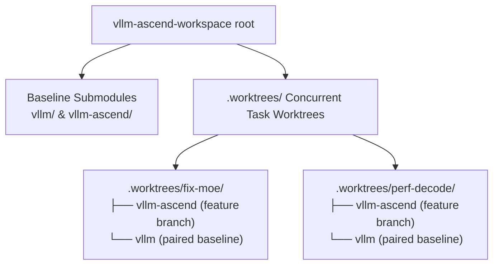

<p align="center">
  
</p>

<div align="center">

# vLLM-Ascend Workspace

**A lightweight, multi-worktree local development scaffold for `vLLM` and `vLLM-Ascend` engineering**  
*面向 `vLLM` 与 `vLLM-Ascend` 多任务并行开发的轻量本地工作区脚手架*

[](https://www.apache.org/licenses/LICENSE-2.0)
[](https://github.com/vllm-project/vllm)
[](https://github.com/vllm-project/vllm-ascend)
[](https://github.com/mindie-agent/mindie-agent)

**[简体中文](README.md)** · **English** · **[Script Reference](.agents/scripts/README.md)** · **[Task Example](.agents/examples/task)** · **[Contributing](CONTRIBUTING.md)**

</div>

---

## 💡 Why Use This Workspace?

When developing features, adapting operators, or reviewing PRs for `vLLM-Ascend`, you often need to **inspect `vllm` and `vllm-ascend` side by side** or **work on multiple independent bugfixes concurrently**.

`vllm-ascend-workspace` gives you a clean, repeatable local setup:
- **Paired Dual-Repo Management**: Tracks `vllm` and `vllm-ascend` upstream baselines as submodules and binds `origin` to your personal GitHub forks in one command.
- **Isolated Task Worktrees**: Creates lightweight Git worktrees under `.worktrees/<task>/` for each task—no more constant `git stash` juggling or cloning multiple multi-gigabyte checkouts.
- **Ready for AI Coding Agents**: Ships pre-configured rule entrypoints for `.claude/`, `.codex/`, `.cursor/`, `.trae/`, and `AGENTS.md`, working seamlessly alongside [MindIE Agent](https://github.com/mindie-agent/mindie-agent).



---

## ⚡ Quick Start

### Option 1: One-Sentence Setup via Your AI Agent (Recommended)

Paste the following sentence into **Claude Code**, **OpenAI Codex CLI**, **Kimi Code**, **DSH**, or **Cursor**:

```text
Please initialize this vLLM-Ascend development workspace and add it to my current client: https://github.com/mindie-agent/vllm-ascend-workspace
```

<details>
<summary>🤖 <b>AI Agent Auto-Setup Protocol (Instructions for AI Agents)</b></summary>

When the user asks you to set up `vllm-ascend-workspace`, execute the following steps automatically:

0. **Complete GitHub sign-in before repository initialization**:
   - Follow [GitHub Sign-In](.agents/github-authentication.md): reuse working authentication; otherwise offer browser or token login, preferring tokens on enterprise networks. Use an existing token through the hidden `gh` prompt or guide creation. Let `gh` save credentials for subsequent Git/PR operations.
   - Reuse an enclosing MindIE Agent installation's verified account and choices. Standalone workspace setup must also run this step; asking for a username does not replace authentication.
1. **Clone or enter the workspace repository**:
   Reuse an existing directory; for a new workspace, clone into the user's selected destination:
   ```bash
   git clone https://github.com/mindie-agent/vllm-ascend-workspace.git "<destination>"
   cd "<destination>"
   ```
2. **Automatically add the path to the current client**:
   - Follow [Native Workspace Registration](.agents/harness-workspace.md) to add the selected absolute path through the native project/workspace entry. Reuse an existing record for the same path without a second registration question.
   - Confirm the path in the client before reporting completion. Deferred or failed source downloads retain the directory and registration for resuming initialization.
3. **Detect the user's GitHub username and initialize submodules & fork remotes**:
   - Read the workspace `AGENTS.md` and [script guide](.agents/scripts/README.md), then read the verified account with `gh api --hostname github.com user --jq .login`.
   - Reuse saved fork selections with `python3 .agents/scripts/repo_init.py --no-input`. For first-time setup using the verified account's existing forks, run:
     ```bash
     python3 .agents/scripts/repo_init.py --github-user <GITHUB_USERNAME> --no-input
     ```
4. **Create an isolated task worktree on demand when starting a task**:
   ```bash
   python3 .agents/scripts/workspace.py task-init .worktrees/<task-name> --title "<task-name>"
   python3 .agents/scripts/workspace.py worktree-add vllm-ascend .worktrees/<task-name>/vllm-ascend --ref HEAD --branch feat/<task-name>
   ```

</details>

---

### Option 2: Manual Terminal Setup (For Humans)

#### 1. Initialize Submodules & Configure Your Forks

Complete [GitHub Sign-In](.agents/github-authentication.md) before initialization.
Reuse working authentication or choose browser/token login; normal setup includes this step.

```bash
# Interactive prompt for your GitHub username or fork URLs
python3 .agents/scripts/repo_init.py

# Or pass your GitHub username directly (sets origin -> your fork, upstream -> vllm-project)
python3 .agents/scripts/repo_init.py --github-user YOUR_GITHUB_USER --no-input
```

Your choices are saved under `forks` in local `workspace.json` and reused automatically on future runs.

Follow [Native Workspace Registration](.agents/harness-workspace.md) to add the workspace root to your current client. Agent-led installation includes this step.

#### 2. Create an Isolated Worktree for a Task

```bash
# 1. Initialize a task directory
python3 .agents/scripts/workspace.py task-init .worktrees/demo --title demo

# 2. Add worktrees for vllm-ascend and vllm (check .github/vllm-main-verified.commit for the paired vLLM ref)
python3 .agents/scripts/workspace.py worktree-add vllm-ascend .worktrees/demo/vllm-ascend --ref HEAD --branch codex/demo
python3 .agents/scripts/workspace.py worktree-add vllm .worktrees/demo/vllm --ref HEAD
```

---

## 📁 Directory Layout

```text
.
├── vllm/                    # vLLM source submodule (upstream -> vllm-project/vllm)
├── vllm-ascend/             # vLLM-Ascend source submodule (upstream -> vllm-project/vllm-ascend)
├── .worktrees/              # Isolated development worktrees per task
├── .vaws-local/             # Local notes, temporary data, and persistent results
├── tools/                   # Optional standalone tool and skill repositories
├── .agents/                 # Shared agent configuration, helper scripts, and examples
│   ├── scripts/             # repo_init.py and workspace.py scripts + documentation
│   └── examples/            # Adaptable task workflow examples
├── .claude/                 # Claude Code project configuration and rule entrypoints
├── .codex/                  # OpenAI Codex project configuration templates
├── .cursor/                 # Cursor project configuration and rule entrypoints
├── .trae/                   # Trae project configuration and rule entrypoints
├── workspace.json.example   # Personal workspace configuration template
├── AGENTS.md                # Agent guidance for workspace development
├── CONTRIBUTING.md          # Workspace scaffold maintenance guide (English)
└── CONTRIBUTING.zh.md       # Workspace scaffold maintenance guide (Chinese)
```

See [`.agents/scripts/README.md`](.agents/scripts/README.md) ([中文](.agents/scripts/README.zh.md)) for full helper command options and [`.agents/examples/task`](.agents/examples/task) ([中文](.agents/examples/task/README.zh.md)) for a complete walkthrough.

---

## 🤝 Contributing

Before modifying helper scripts, configuration templates, or documentation in this scaffold, please read [`CONTRIBUTING.md`](CONTRIBUTING.md) ([中文](CONTRIBUTING.zh.md)). Code contributions to `vLLM` and `vLLM-Ascend` follow the upstream guidelines in their respective repositories.
