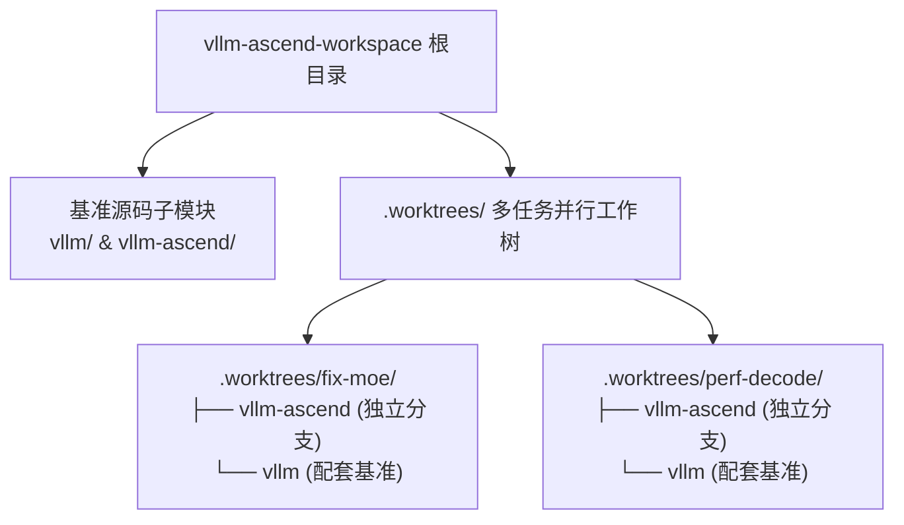

<p align="center">
  
</p>

<div align="center">

# vLLM-Ascend Workspace

**面向 `vLLM` 与 `vLLM-Ascend` 多任务并行开发的轻量本地工作区脚手架**  
*A lightweight, multi-worktree local development scaffold for `vLLM` and `vLLM-Ascend` engineering.*

[](LICENSE)
[](https://github.com/vllm-project/vllm)
[](https://github.com/vllm-project/vllm-ascend)
[](https://github.com/mindie-agent/mindie-agent)

**简体中文** · **[English](README.en.md)** · **[脚本说明](.agents/scripts/README.zh.md)** · **[任务示例](.agents/examples/task/README.zh.md)** · **[维护指南](CONTRIBUTING.zh.md)**

</div>

---

## 💡 为什么需要这个工作区？

在做 `vLLM-Ascend` 开发、算子适配或 PR 检视时，开发者经常需要**同时对比 `vllm` 主仓与 `vllm-ascend` 插件仓的代码**，或者**同时推进多个互不干扰的修复分支**。

`vllm-ascend-workspace` 提供了一个开箱即用的本地多任务脚手架：
- **双仓联动管理**：通过 Git 子模块统一维护 `vllm` 与 `vllm-ascend` 上游基准，并一键将 `origin` 绑定到你自己的 GitHub Fork。
- **多任务 Git Worktree 隔离**：每个开发任务在 `.worktrees/<task>/` 下拥有独立的 `vllm` 与 `vllm-ascend` 工作树，无需反复 `git stash` 或克隆多份几十 GB 的仓库。
- **多 Agent 规则预置**：内置 `.claude/`、`.codex/`、`.cursor/`、`.trae/` 与 `AGENTS.md` 规则入口，配合 [MindIE Agent](https://github.com/mindie-agent/mindie-agent) 开箱即用。



---

## ⚡ 快速开始（Quick Start）

### 方式一：一句话让你的 AI Agent 自动初始化（推荐）

直接把下面这句话发给你的 **Claude Code**、**Codex**、**Kimi Code** 或 **Cursor**：

```text
帮我初始化这个 vLLM-Ascend 开发工作区：https://github.com/mindie-agent/vllm-ascend-workspace
```

<details>
<summary>🤖 <b>AI Agent 自动初始化协议（Instructions for AI Agents）</b></summary>

当你收到用户要求初始化 `vllm-ascend-workspace` 的指令时，请自动按顺序执行以下步骤：

1. **克隆或进入工作区仓库**：
   ```bash
   git clone https://github.com/mindie-agent/vllm-ascend-workspace.git
   cd vllm-ascend-workspace
   ```
2. **获取用户的 GitHub 用户名并初始化双仓子模块与 Fork 远端**：
   - 先尝试通过 `gh api user -q .login` 自动获取当前登录的 GitHub 用户名；若未安装 `gh`，再询问用户。
   - 执行非交互初始化：
     ```bash
     python3 .agents/scripts/repo_init.py --github-user <GITHUB_USERNAME> --no-input
     ```
3. **按用户当前任务按需创建独立 Worktree（如需开始具体任务）**：
   ```bash
   python3 .agents/scripts/workspace.py task-init .worktrees/<task-name> --title "<task-name>"
   python3 .agents/scripts/workspace.py worktree-add vllm-ascend .worktrees/<task-name>/vllm-ascend --ref HEAD --branch feat/<task-name>
   ```

</details>

---

### 方式二：终端手动初始化（For Humans）

#### 1. 初始化源码并绑定个人 Fork

```bash
# 交互式输入 GitHub 用户名或 Fork 地址
python3 .agents/scripts/repo_init.py

# 或直接指定 GitHub 用户名一键完成（自动将 origin 指向你的 Fork，upstream 指向 vllm-project）
python3 .agents/scripts/repo_init.py --github-user YOUR_GITHUB_USER --no-input
```

配置会自动保存在本地 `workspace.json` 的 `forks` 字段中，后续重复运行会自动复用。

#### 2. 为新任务创建独立的并行工作树（Worktree）

```bash
# 1. 创建任务目录
python3 .agents/scripts/workspace.py task-init .worktrees/demo --title demo

# 2. 为 vllm-ascend 和 vllm 分别拉起独立工作树（可参考 .github/vllm-main-verified.commit 选择配套的 vllm 版本）
python3 .agents/scripts/workspace.py worktree-add vllm-ascend .worktrees/demo/vllm-ascend --ref HEAD --branch codex/demo
python3 .agents/scripts/workspace.py worktree-add vllm .worktrees/demo/vllm --ref HEAD
```

---

## 📁 目录结构一览

```text
.
├── vllm/                    # vLLM 源码子模块（upstream -> vllm-project/vllm）
├── vllm-ascend/             # vLLM-Ascend 源码子模块（upstream -> vllm-project/vllm-ascend）
├── .worktrees/              # 多任务并行开发工作树目录（每个任务独立分支）
├── .vaws-local/             # 本地任务笔记、临时数据与持久化结果
├── tools/                   # 按需放入的独立辅助工具与技能仓库
├── .agents/                 # 共享 Agent 配置、初始化/工作树管理脚本与任务示例
│   ├── scripts/             # repo_init.py 与 workspace.py 脚本及文档
│   └── examples/            # 任务工作流示例
├── .claude/                 # Claude Code 项目配置与规则入口
├── .codex/                  # OpenAI Codex 项目配置模板
├── .cursor/                 # Cursor 项目配置与规则入口
├── .trae/                   # Trae 项目配置与规则入口
├── workspace.json.example   # 个人工作区配置模板
├── AGENTS.md                # 工作区 Agent 协作约定
├── CONTRIBUTING.zh.md       # 工作区脚手架维护指南（中文）
└── CONTRIBUTING.md          # 工作区脚手架维护指南（英文）
```

详细脚本参数说明见 [`.agents/scripts/README.zh.md`](.agents/scripts/README.zh.md)（[English](.agents/scripts/README.md)），完整任务示例见 [`.agents/examples/task/README.zh.md`](.agents/examples/task/README.zh.md)。

---

## 🤝 维护与贡献

修改本工作区的辅助脚本、配置模板或文档前，请阅读 [`CONTRIBUTING.zh.md`](CONTRIBUTING.zh.md)（[English](CONTRIBUTING.md)）。针对 `vLLM` 与 `vLLM-Ascend` 本身的代码贡献，请直接遵循各自上游源码仓库的贡献规范。
